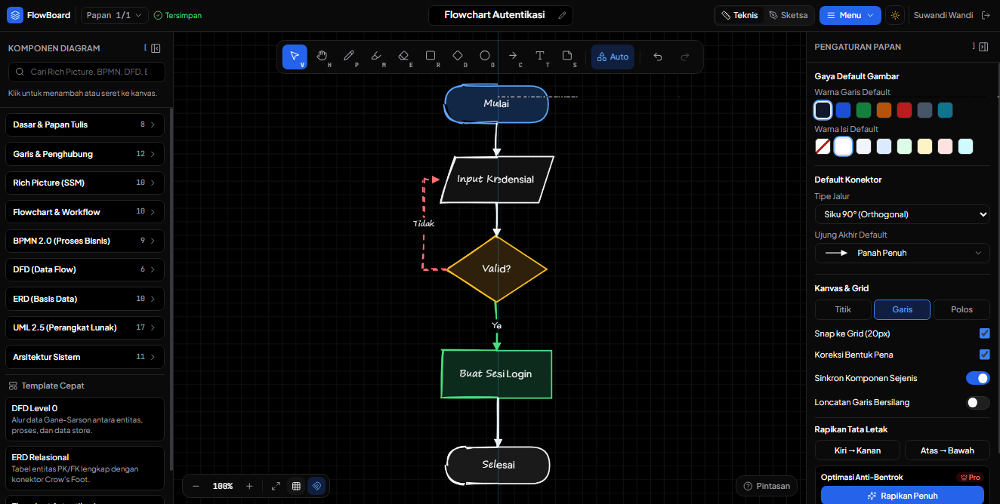

<div align="center">



<h1>
  
  &nbsp;FlowBoard
</h1>

<p>
  <a href="https://flow-board-dun.vercel.app/"></a>
  <a href="https://github.com/Aldikurniawan19/flow-board/actions/workflows/ci.yml"></a>
  <a href="LICENSE"></a>
  
  
  
</p>

**Platform perancangan diagram teknis dan papan tulis vektor interaktif berbasis HTML5 Canvas, dengan mesin routing ortogonal anti-halangan, kompilator PlantText/PlantUML, serta integrasi Model Context Protocol (MCP) dan OAuth 2.1.**

</div>

---

## Ringkasan Arsitektur

FlowBoard dibangun sebagai aplikasi _full-stack_ JavaScript (ESM) dengan arsitektur _client-side vector canvas engine_ dan _stateless/serverless-ready REST + MCP backend_:

- **Mesin Render Kanvas 2D (`src/engine/`):** Merender elemen vektor dengan _high-DPI backing-store supersampling_, mendukung peralihan instan antara mode **Teknis (presisi geometris)** dan **Sketsa (Rough.js)** serta palet tema terang dan gelap hitam pekat (`#000000`).
- **Manajemen State & Persistensi (`src/store/`):** Menggunakan **Zustand** dengan riwayat _undo/redo_ berbasis _immutable snapshot_, validasi skema **Zod**, serta _debounced autosave_ ke backend.
- **Backend Dual-Dialect (`server/`):** Dibangun di atas **Express 5** dan mendukung **Supabase PostgreSQL (`pg`)** untuk produksi _serverless_ (Vercel) serta **SQLite (`node:sqlite`)** secara otomatis untuk lingkungan lokal tanpa konfigurasi tambahan.

---

## Spesifikasi Teknis & Kapabilitas

### 1. Mesin Grafis, Interaksi Kanvas, & Pengenalan Bentuk

- **Dual-Mode Rendering & Adaptive Palette:** Mendukung gaya _Clean Technical_ dan _Hand-Drawn Sketch_ (Rough.js) dengan transformasi palet otomatis untuk tema terang dan gelap (`#000000`).
- **Freehand & Shape Recognition:** Goresan bebas dan stabilo dirender melalui `perfect-freehand`, dilengkapi pengenalan bentuk heuristik (_auto-correct_) ke primitif geometris standar yang dapat dikembalikan ke goresan mentah melalui satu operasi `Ctrl+Z`.
- **Kontrol Manipulasi Presisi:**
  - _Viewport pan/zoom_ berbasis matriks kamera (`screenToWorld` / `worldToScreen`), _grid snapping_ (20px), _smart alignment guides_, serta _nudge_ piksel via tombol panah.
  - **Rotasi Sudut Kanan Atas:** Handle rotasi ditempatkan di sudut kanan atas (_NE_) dengan perhitungan delta sudut relatif terhadap titik awal tarikan, snap magnetik pada sudut kardinal (0°/90°/180°/270°) atau kelipatan 15° (`Shift`), dan hanya berlaku pada komponen yang dipilih.
  - **Kursor Kontekstual:** Termasuk kursor SVG penghapus khusus saat mode `Eraser` (`E`) dengan _hotspot_ presisi di ujung hapus.

### 2. Katalog Notasi Teknis (81 Komponen + 12 Preset Konektor)

Seluruh simbol didefinisikan secara deklaratif pada `src/engine/shapeRegistry.js` dan tervalidasi penuh terhadap `ElementSchema` (Zod):

| Domain Notasi                | Jumlah | Cakupan Elemen                                                                                                                                                                       |
| ---------------------------- | :----: | ------------------------------------------------------------------------------------------------------------------------------------------------------------------------------------ |
| **Dasar & Papan Tulis**      |   8    | Persegi, persegi membulat, elips, belah ketupat, segitiga, segi enam, catatan tempel, bingkai (_frame_)                                                                              |
| **Garis & Penghubung**       |   12   | Panah lurus/siku 90°/kurva, garis polos, panah dua arah, putus-putus, notasi UML (_Inheritance, Realization, Aggregation, Composition_), dan relasi ERD _Crow's Foot_ (`1:N`, `N:M`) |
| **Rich Picture (SSM)**       |   10   | Stakeholder, tim/divisi, balon pikiran, balon ucapan, konflik, pengawasan, krisis, instansi, anggaran, arsip                                                                         |
| **Flowchart & Workflow**     |   10   | Terminator, proses, keputusan, I/O, dokumen, sub-proses, basis data, operasi manual, tunda, konektor halaman                                                                         |
| **BPMN 2.0 (ISO/IEC 19510)** |   9    | Start/Intermediate/End Event, Task, Sub-Process, Gateway XOR/AND, Data Object, Pool                                                                                                  |
| **DFD**                      |   6    | Notasi **Gane & Sarson** dan **Yourdon & DeMarco** (Proses, Data Store, Entitas Eksternal)                                                                                           |
| **ERD**                      |   10   | Tabel relasional & entitas lemah (editor atribut `PK`, `FK`, `PK,FK`, tipe data) serta notasi **Peter Chen**                                                                         |
| **UML 2.5**                  |   17   | Class, Interface, Package, Note, Use Case, Sequence (_Lifeline, Activation, Combined Fragment_), Activity, Component, Node                                                           |
| **Arsitektur Sistem**        |   11   | Server, Cloud, Database, Queue, API Gateway, Browser, Mobile, Cache, Firewall, Object Storage, External API                                                                          |

### 3. Mesin Routing Konektor & Quick-Connect

- **Quick-Connect 4 Sisi (3-State):**
  - _Hover komponen:_ menampilkan 4 panah blok di titik tengah sisi (sadar rotasi) beserta indikator port tepi (`×`).
  - _Hover panah:_ menyorot panah dan memunculkan _quick strip_ berisi 4 simbol inti.
  - _Klik panah:_ membuka _popover_ ringkas 4×2 (8 simbol umum) untuk membuat simbol baru searah panah sekaligus menautkan konektor terikat dalam satu transaksi _undo_.
  - _Drag panah:_ langsung menarik konektor bebas yang menempel ke port komponen tujuan.
- **Interactive A\* Obstacle-Avoiding Router (`rerouteSingleConnector`):** Ketika pengguna menarik atau memindahkan ujung konektor—termasuk ke sisi berlawanan secara ekstrim—algoritma \*visibility-grid A\*\* merutekan jalur ortogonal mengelilingi seluruh komponen (termasuk bodi sumber dan tujuan), menghindari tumpang tindih dengan jalur lain, dan secara adaptif mengevaluasi 4 sisi port ujung lawan guna menghilangkan persilangan maupun jalur memutar yang tidak perlu.
- **Kontrol Konektor Lanjutan:**
  - _Flexible Perimeter Anchoring:_ pengikatan proporsional (`rx`, `ry`) di sepanjang tepi atau interior komponen (`Alt`).
  - _Free-Drag Connector Labels:_ teks label dapat diseret bebas di kanvas dengan garis panduan (_tether_) serta tombol _Reset Posisi_.
  - _Line Jumps (`/\\`):_ deteksi persilangan antar-segmen dengan lompatan bersudut tajam yang dapat diaktifkan/dinonaktifkan per papan (`settings.lineJumps`) secara konsisten di kanvas, ekspor PNG, dan ekspor SVG.
  - _Stroke Style Scope:_ pengaturan pola garis (`solid`, `dashed`, `dotted`) mendukung cakupan **Terpilih** (hanya elemen aktif) maupun **Semua** (seluruh elemen sejenis pada papan).

### 4. Kompilator PlantText / PlantUML & Optimasi Tata Letak (Pro)

- **PlantText/PlantUML Parser (`src/engine/plantTextParser.js`):** Mengonversi sintaks PlantUML/PlantText (ERD, DFD, UML Class/Use Case/Sequence, Flowchart) menjadi elemen vektor native yang sepenuhnya dapat diedit di kanvas.
- **Conflict-Driven Diagram Tidy Optimizer (`src/engine/autoLayout.js`):** Tersedia untuk akun **Pro** melalui dua mode operasi:
  - **Rapikan Penuh (`full`):** Penempatan hierarkis berbasis Sugiyama, pengurutan lapisan _barycenter + 2-opt_ (mempertahankan urutan numerik proses DFD), alokasi lajur koridor _Left-Edge_, A\* _obstacle avoidance_, _edge nudging_, serta penempatan label anti-tabrakan.
  - **Rapikan Garis & Label Saja (`connectors_only`):** Mengunci koordinat seluruh komponen dan hanya mengoptimalkan alokasi port, jalur konektor, dan posisi label.

### 5. Integrasi AI, Model Context Protocol (MCP), & Keamanan

- **MCP & OAuth 2.1 Compliant:** Mendukung koneksi langsung ke klien AI (**Google Gemini**, **ChatGPT**, **Claude**) lengkap dengan _Protected Resource Metadata_ (RFC 9728), _Authorization Server Metadata_ (RFC 8414), _Dynamic Client Registration_ (RFC 7591), _PKCE S256_, _Resource Indicators_ (RFC 8707), rotasi _refresh token_, dan pencabutan token (RFC 7009).
- **Autentikasi & Perlindungan Akses:**
  - Mendukung login email/kata sandi (`bcryptjs`) dan **Sign in with Google (OAuth 2.0 + PKCE S256)** dengan verifikasi _state_ anti-CSRF dan proteksi _open redirect_.
  - Sesi cookie `HttpOnly`, validasi header CSRF (`X-Requested-With`), _security headers_, _rate limiting_, serta isolasi kepemilikan data ketat (anti-IDOR) di setiap endpoint papan kerja, API key, dan koneksi OAuth.
- **Ekspor Multi-Format (`src/engine/exporter.js`):** Ekspor ke **PNG (2× HD, latar terang/gelap/transparan)**, **SVG vektor** dengan sanitasi XML, dan **JSON proyek** (`.flowboard.json`) tervalidasi Zod.

---

## Stack Teknologi

| Lapisan             | Teknologi                                                                                    |
| ------------------- | -------------------------------------------------------------------------------------------- |
| **Frontend UI**     | React 19, Vite 6, Tailwind CSS v4, Zustand, Lucide React                                     |
| **Grafis & Kanvas** | HTML5 2D Canvas API, Rough.js, `perfect-freehand`                                            |
| **Backend & HTTP**  | Node.js 22+, Express 5, `bcryptjs`, `cookie-parser`                                          |
| **Database**        | PostgreSQL (`pg` / Supabase Transaction Pooler) & Node.js SQLite (`node:sqlite`)             |
| **Validasi & QA**   | Zod, TypeScript (`tsc --noEmit` via JSDoc), ESLint, Vitest, Supertest, React Testing Library |

---

## Konfigurasi & Pengembangan Lokal

### Prasyarat

- **Node.js 22+** dan **npm**

### Variabel Lingkungan

Salin `.env.example` menjadi `.env` jika ingin mengaktifkan PostgreSQL atau Login Google:

| Variabel               |  Wajib   | Keterangan                                                                                                                     |
| ---------------------- | :------: | ------------------------------------------------------------------------------------------------------------------------------ |
| `DATABASE_URL`         | Opsional | URI PostgreSQL (disarankan Supabase Transaction Pooler port `6543` di Vercel). Jika kosong, otomatis menggunakan SQLite lokal. |
| `COOKIE_SECURE`        | Opsional | Set `true` pada lingkungan HTTPS produksi (otomatis aktif di Vercel).                                                          |
| `GOOGLE_CLIENT_ID`     | Opsional | OAuth 2.0 Client ID dari Google Cloud Console untuk _Sign in with Google_.                                                     |
| `GOOGLE_CLIENT_SECRET` | Opsional | OAuth 2.0 Client Secret pasangan `GOOGLE_CLIENT_ID`.                                                                           |
| `GOOGLE_REDIRECT_URI`  | Opsional | _Override_ URI callback OAuth jika berada di balik _custom domain_ atau _reverse proxy_.                                       |

### Instalasi & Eksekusi

```bash
# Pasang dependensi
npm install

# Jalankan backend Express (watch mode) dan frontend Vite secara paralel
npm run dev
```

### Verifikasi Kualitas & Build Produksi

```bash
npm run typecheck   # Pemeriksaan tipe statis (tsc --noEmit -p jsconfig.json)
npm run lint        # Analisis statis ESLint
npm test            # Menjalankan seluruh suite pengujian (unit, auto-layout, API/security, UI)
npm run build       # Kompilasi bundle produksi Vite ke dist/
```

---

## Struktur Direktori

```text
├── api/             # Entrypoint Serverless Function untuk deployment Vercel
├── public/
│   └── assets/      # Aset statis dan gambar pratinjau aplikasi
├── server/
│   ├── middleware/  # Autentikasi sesi/Bearer/API key, header keamanan, CSRF, rate limiter
│   ├── routes/      # Router Auth (Email & Google), Boards, OAuth 2.1, MCP, REST v1, API Keys
│   ├── services/    # Layanan generasi & serialisasi diagram sisi server
│   ├── app.js       # Konfigurasi Express app dan error handler terpusat
│   └── db.js        # Abstraksi dual-dialect PostgreSQL / SQLite & migrasi skema
└── src/
    ├── components/  # Antarmuka workspace (Kanvas, QuickConnectMenu, Sidebar, Inspector, Modal)
    ├── constants/   # Design tokens, palet kanvas terang/gelap, dan template bawaan
    ├── engine/      # Kamera, geometri, port fleksibel, router ortogonal, A* auto-layout, PlantText parser, renderer, exporter
    ├── store/       # Store Zustand (undo/redo, autosave, sinkronisasi) dan API client
    ├── types/       # Definisi tipe JSDoc dan skema validasi Zod
    └── tests/       # Suite pengujian engine, auto-layout, API & keamanan, serta integrasi UI
```

---

## Lisensi

Proyek ini didistribusikan di bawah lisensi **MIT**. Lihat berkas [LICENSE](LICENSE) untuk detail selengkapnya.
